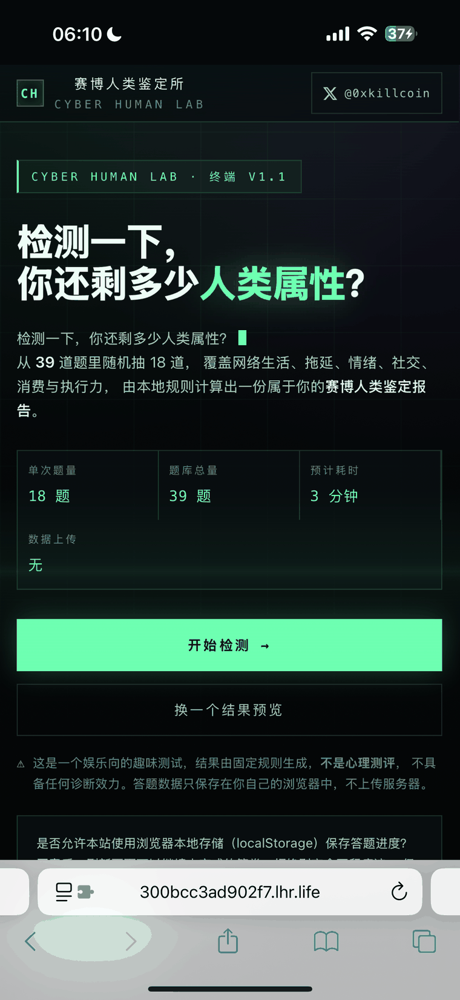
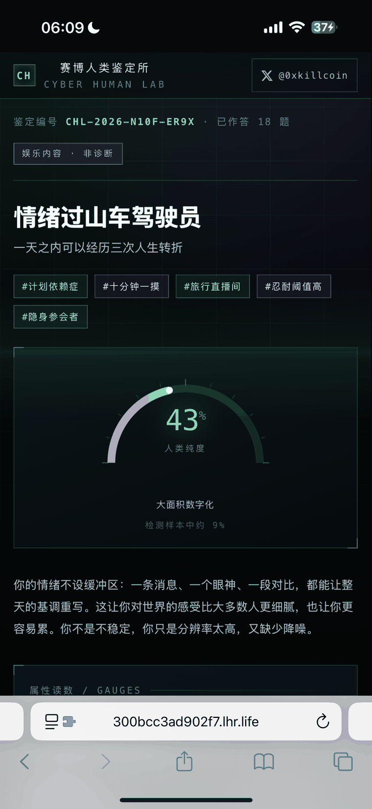
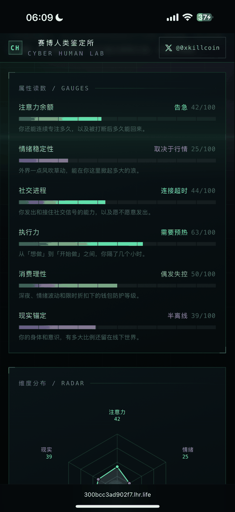
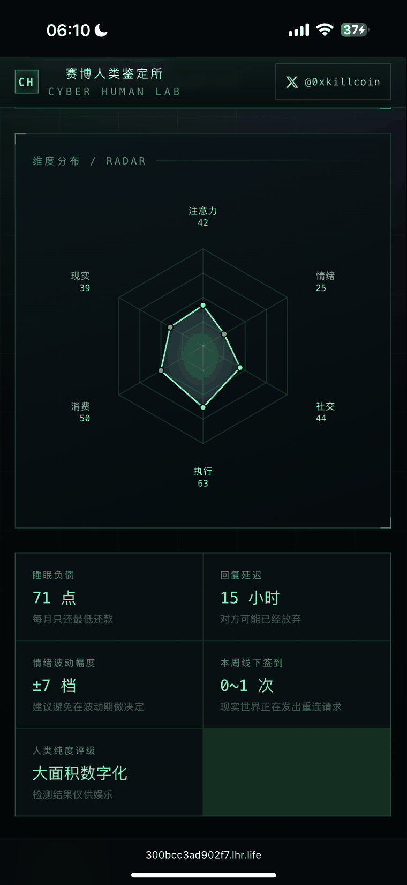
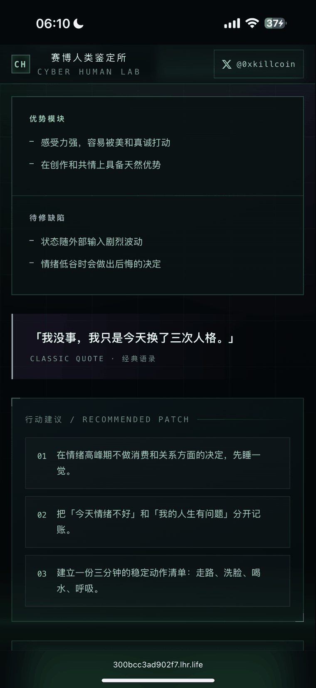
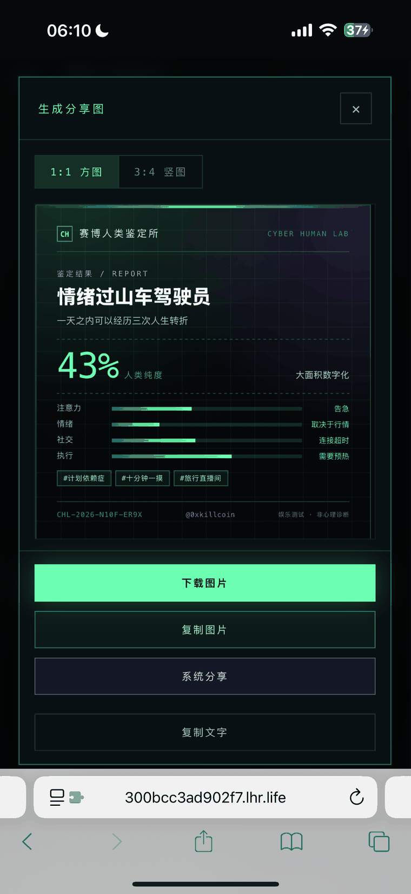
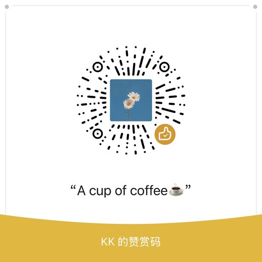

<div align="center">

# 赛博人类鉴定所

**Cyber Human Lab**

### 检测一下，你还剩多少人类属性？

一个纯前端的娱乐向「赛博人类」人格鉴定终端 · 64 道题库随机组卷 · 16 种人格类型 · 生成可分享的鉴定报告

[](https://iiiiiiiiiiiiiKK.github.io/CyberHuman/)
[](https://CyberHuman.321.market)
[](https://x.com/0xkillcoin)

[](https://react.dev/)
[](https://www.typescriptlang.org/)
[](https://vite.dev/)
[](#-测试)
[](LICENSE)
[](#-隐私与数据)

</div>

---

> [!WARNING]
> **这是一个娱乐向的趣味测试，不是心理测评。**
> 所有结果由写死的本地规则计算得出，不构成心理诊断、医学建议或任何形式的科学结论，
> 不应作为评价自己或他人的依据。如果你正在经历持续的情绪困扰，请寻求专业心理服务。

---

## 📖 这是什么

你有没有想过，自己每天花在屏幕上的时间、拖延的习惯、看到消息不敢回的那三秒、
深夜购物车里躺着的东西——加起来会把你变成一个什么样的人？

**赛博人类鉴定所**想用 18 道题测量这件事，然后给你一份看起来很专业的报告：

| 指标 | 示例读数 |
| --- | --- |
| 人类纯度 | `37%` |
| 注意力余额 | `负数` |
| 情绪稳定性 | `取决于行情` |
| 社交进程 | `连接超时` |
| 最终鉴定 | **互联网原住民，现实世界游客** |

报告不是随便生成的。它有六个可量化维度、64 道题的题库、做归一化处理的评分引擎、
16 种带完整描述的人格类型，以及可以导出成 1080×1080 / 1080×1440 图片的分享卡。

---

## ✨ 特性

<table>
<tr>
<td width="50%" valign="top">

### 🎲 每次测得都不一样

- **64 道题库**，每次随机抽 **18 道**
- 按主题配额定数，保证覆盖全部 7 个主题
- 题目顺序、选项顺序都打乱
- 两次独立测试平均只重合 **5.3 / 18（29%）**
- 刷新恢复时用同一种子重建**完全相同**的试卷

</td>
<td width="50%" valign="top">

### 🧮 真的在算，不是随机贴标签

- 6 维度加权评分 + 按题组 σ 做归一化
- 同一份试卷 + 同样答案 → **永远同一结果**
- 16 种人格类型，各有优势/弱点/语录/行动建议
- 鉴定编号由分数哈希生成，可复现
- 规则与内容完全分离，加题不改引擎

</td>
</tr>
<tr>
<td valign="top">

### 🖼️ 分享图开箱可用

- 1:1 → **1080×1080**，3:4 → **1080×1440**
- DOM 截图导出，不是 Canvas 手绘
- 字号按内容自适应，长类型名不会被裁
- 下载 / 复制图片 / 系统分享 / 复制文字四条路径
- 每条都有降级方案与状态反馈

</td>
<td valign="top">

### 🔒 隐私是真的隐私

- 无账号、无数据库、无后端接口
- 纯静态产物，答案**从不出浏览器**
- 必须你**明确同意**才写 localStorage
- 拒绝 = 完全不留痕迹
- 页脚一键清除本地数据

</td>
</tr>
<tr>
<td valign="top">

### 📱 手机和桌面同一套代码

- 320 / 390 / 768 / 1440 四种视口零横向溢出
- 选项触摸高度 ≥ 66px，主按钮 ≥ 50px
- 适配刘海屏、去掉点击高亮、消除 300ms 延迟
- 键盘全流程可用（`1–5` 选择、`←→` 翻页）

</td>
<td valign="top">

### 🖥️ 赛博检测终端美学

- 深色底 + 荧光绿 + 紫色，网格 + 扫描线 + 光束
- 等宽字体承载数据，无衬线字体承载正文
- 动画克制，`prefers-reduced-motion` 下全部关闭
- 不使用模板化 SaaS 布局与廉价玻璃卡片

</td>
</tr>
</table>

---

## 📸 界面预览

### 首页

<div align="center">
  
</div>

强烈的标题、规格条（单次题量 / 题库总量 / 预计耗时 / 数据上传）、
随机结果预览卡、本地存储同意条，以及两处娱乐属性声明。

### 鉴定报告

<div align="center">
  
</div>

鉴定编号、人格类型、副标题、趣味标签，以及半圆形的「人类纯度」表盘。

<table>
<tr>
<td width="50%" align="center">
  <br>
  <sub><b>属性读数</b> — 六维度进度条 + 档位文案</sub>
</td>
<td width="50%" align="center">
  <br>
  <sub><b>维度分布</b> — 手写 SVG 雷达图</sub>
</td>
</tr>
</table>

<div align="center">
  <br>
  <sub><b>报告正文</b> — 附加指标、优势/弱点、经典语录、行动建议</sub>
</div>

### 分享图

<div align="center">
  
</div>

1:1 与 3:4 两种比例，含品牌名、结果名称、核心数值、维度读数、作者标识与娱乐声明。

---

## 🎯 六个维度

| 维度 | 展示名 | 权重 | 测什么 |
| --- | --- | --- | --- |
| `attention` | 注意力余额 | 0.20 | 你还能连续专注多久，被打断后多久能回来 |
| `emotion` | 情绪稳定性 | 0.20 | 外界一点风吹草动，能在你这里掀起多大的浪 |
| `execution` | 执行力 | 0.20 | 从「想做」到「开始做」之间，隔了几个小时 |
| `social` | 社交进程 | 0.15 | 你发出和接住社交信号的能力，以及愿不愿意发出 |
| `reality` | 现实锚定 | 0.15 | 你的身体和意识，有多大比例还留在线下世界 |
| `wallet` | 消费理性 | 0.10 | 深夜、情绪波动和限时折扣下的钱包防护等级 |

每个维度有 5 档文案，从高到低匹配：

```
注意力余额：余额充足 → 正常可用 → 偏低 → 告急 → 负数
情绪稳定性：稳定 → 基本稳定 → 看情况 → 取决于行情 → 过山车型
社交进程：  满速连接 → 正常连接 → 轻微延迟 → 连接超时 → 无响应
执行力：    工业级 → 稳定输出 → 需要预热 → 待启动 → 未安装
消费理性：  冷静克制 → 基本理性 → 偶发失控 → 高危 → 无底洞
现实锚定：  锚定良好 → 现实在线 → 来回游荡 → 半离线 → 已离线
```

---

## 🧬 16 种人格类型

<details>
<summary><b>点击展开完整列表</b></summary>

| 代号 | 名称 | 一句话 |
| --- | --- | --- |
| `INDUSTRIAL-HUMAN` | 工业级人类 | 稳定、清醒、按时交付 |
| `DEADLINE-GOLEM` | 截止日期魔像 | 平时是石头，DDL 前是神 |
| `PERFECTIONIST-SNAIL` | 完美主义蜗牛 | 想得很清楚，就是还没开始 |
| `ATTENTION-BANKRUPT` | 注意力破产者 | 余额不足，且已透支 |
| `REALITY-TOURIST` | 互联网原住民，现实世界游客 | 在线时长满级，线下偶尔签到 |
| `OFFLINE-HERMIT` | 半离线隐士 | 世界很吵，我这边信号不好 |
| `SOCIAL-TIMEOUT` | 社交连接超时 | 请求已发出，未收到响应 |
| `EMO-ROLLERCOASTER` | 情绪过山车驾驶员 | 一天之内可以经历三次人生转折 |
| `WALLET-BLACKHOLE` | 钱包黑洞 | 钱没有消失，只是转移到了别的地方 |
| `MARKET-ATTACHMENT` | 行情依附体 | 情绪稳定性：取决于行情 |
| `MEME-ENGINE` | 互联网话事人 | 群里的气氛由你供电 |
| `NIGHT-GHOST` | 夜间游魂 | 白天是 NPC，凌晨才是主角 |
| `CONTENT-VACUUM` | 内容黑洞 | 摄入量惊人，留存率感人 |
| `CALCULATOR-HUMAN` | 精算人类 | 情绪稳定，钱包冷静，风险可控 |
| `QUIET-OBSERVER` | 静音观察者 | 不说话，但什么都看见了 |
| `BUFFERING-HUMAN` | 缓冲中的人类 | 各项指标均衡，偶尔卡顿 |

</details>

每种类型都有：名称、代号、副标题、完整描述、3 条优势、2 条弱点、经典语录、
3 条行动建议、趣味标签、稀有度提示。

---

## 🔬 评分引擎

### 计算流程

```
答案
 │
 ├─ 1. 累加      每个维度从基准分 50 出发，按选项的 effects 加减
 │
 ├─ 2. 归一化    按「本次试卷实际抽到的题」算理论标准差 σ，
 │              把各维度偏差统一放大到目标 σ=17
 │
 ├─ 3. 加权纯度  六维度按权重加权平均，四舍五入
 │
 ├─ 4. 类型匹配  按结果类型数组顺序，第一个全部条件满足的胜出
 │              （最后一个类型无条件兜底，保证一定有结果）
 │
 └─ 5. 标签指标  从实际选择里收集标签，由分数推导睡眠负债等趣味指标
```

**为什么需要第 2 步的归一化**：不同维度被题目触及的密度差很多（情绪 75%、消费 30%），
直接相加会让某些维度「天生」波动更大，量表不可比。归一化前所有读数挤在 33–75 之间，
归一化后能自然铺开到 0–100。

### 随机组卷的配额设计

配额不是按主题平均切分，而是按「各维度被题目触及的密度」反推：

| 主题 | 题池 | 配额 | 理由 |
| --- | ---: | ---: | --- |
| 注意力 | 9 | 3 | — |
| 社交 | 11 | 4 | 题池大但只有 42% 的题触及社交维度，需更高配额补足 |
| 消费 | 11 | 3 | 触及率最低（30%），必须给足 |
| 网络依赖 | 9 | 2 | 常连带影响现实锚定 |
| 情绪 | 8 | 2 | 75% 的题都触及情绪，配额低也不缺样本 |
| 拖延 | 8 | 2 | — |
| 执行力 | 8 | 2 | — |

衡量指标是「维度权重 ÷ 单份试卷平均有效题数」，六维度越接近越公平。
配额平均时该比值离散度 **CV = 14%**；按上表调整后降到 **CV = 7.0%**。

### 实测数据

| 指标 | 数值 |
| --- | --- |
| 题库总量 | **64 道** |
| 单次题量 | **18 道** |
| 两次独立测试平均重合 | **5.3 / 18（29%）** |
| 重合 ≥12 题的组合占比 | **0%** |
| 1000 次采样的题目组合数 | **1000 种** |
| 维度均衡度 CV | **7.0%** |
| 可达人格类型 | **16 / 16** |

---

## 🚀 快速开始

```bash
# 安装依赖
npm install

# 本地开发
npm run dev        # http://127.0.0.1:5173/

# 生产构建
npm run build      # 输出到 dist/

# 本地预览构建产物
npm run preview    # http://127.0.0.1:4173/
```

**环境要求**：Node.js ≥ 18（开发用 Node 24 验证），npm ≥ 9。

> [!NOTE]
> 若所在网络存在 TLS 中间人导致 `npm install` 报 `SELF_SIGNED_CERT_IN_CHAIN`，
> 可临时用 `npm install --strict-ssl=false`，或修复本机根证书。
> 仓库内 `.npmrc` 已设 `strict-ssl=false` 以便受限网络安装。

---

## 🧪 测试

```bash
npm test             # 评分引擎 + 抽题器：1533 项断言（无需浏览器）
npm run test:e2e     # 浏览器 E2E：62 项断言（需先 npm run preview）
npm run test:share   # 分享图导出尺寸与留白校验
npm run test:stress  # 分享卡裁切压力测试：16 类型 × 2 比例（需 dev server）
npm run test:layout  # 4 视口 × 4 页面的布局/点击区体检
```

| 套件 | 结果 |
| --- | --- |
| `npm test` | **1533 通过 / 0 失败** |
| `npm run test:e2e` | **62 通过 / 0 失败** |
| `npm run test:share` | 1080×1080 / 1080×1440 均正确 |
| `npm run test:stress` | 32 张卡，硬性裁切 **0** |
| `npm run test:layout` | 4 视口 × 4 页面，**0 问题** |

**自测覆盖**：题库结构合法性、id 唯一性、维度分值范围、主题配额自洽、
每份试卷覆盖 7 主题、组合多样性、题目出现率均衡、选项顺序打乱、
维度触及率 ≥25%、权重/题数离散度 ≤10%、消费维度单卷有效题数、
两次测试重合度、随机 4000 次命中 ≥10 种类型、脏数据容错、空答案兜底。

**E2E 覆盖**：首页渲染 → 作者 X 链接 → 同意存储 → 键盘答题 → 上一步改答案 →
刷新恢复（含试卷种子一致性）→ 答完 18 题 → 检测动画 → 结果页各区块 →
复制结果 → 分享图（两种比例 + 裁切检测 + 真实下载）→ 回看改题 →
确定性一致 → 重新测试换卷 → 清除本地数据 → 拒绝存储不写盘 → 移动端布局。

---

## 📁 目录结构

```
CyberHuman/
├── index.html                    # 入口 HTML（OG / 描述 / 主题色）
├── vite.config.ts                # Vite 配置（base: './' 支持任意子路径）
├── share-stress.html             # 分享卡压力测试页（仅 dev 可用）
├── docs/images/                  # README 截图与打赏码
├── public/favicon.svg
├── src/
│   ├── App.tsx                   # 顶层状态机 home/quiz/computing/result/review
│   ├── data/                     # ← 内容层：改内容不用碰引擎
│   │   ├── site.ts               # 品牌、标语、免责声明、作者链接
│   │   ├── dimensions.ts         # 6 维度定义、权重、档位文案
│   │   ├── questions.ts          # 题库 64 道 + 主题配额
│   │   └── archetypes.ts         # 16 种人格类型
│   ├── lib/                      # ← 规则层：纯函数，可单测
│   │   ├── paper.ts              # 抽题器（配额抽题 + 打乱）
│   │   ├── scoring.ts            # 评分引擎
│   │   ├── storage.ts            # localStorage 封装
│   │   ├── image.ts              # 分享图导出 / 剪贴板 / 系统分享
│   │   └── share.ts              # 结果文本序列化
│   ├── pages/                    # Home / Quiz / Result / Review
│   ├── components/               # ShareCard / ShareModal / RadarChart / …
│   └── styles/                   # global.css + share.css
└── scripts/                      # 开发期测试脚本
```

---

## 🌐 部署

### GitHub Pages（本仓库已配置）

仓库内置 `.github/workflows/deploy.yml`：推送 `main` 分支 → 自动构建 → 发布到 Pages。

**开启方式**：仓库 `Settings → Pages → Build and deployment → Source` 选择 **GitHub Actions**。

随后每次推送自动部署到：

```
https://iiiiiiiiiiiiiKK.github.io/CyberHuman/
```

### 绑定自定义域名 CyberHuman.321.market

1. 仓库 `Settings → Pages → Custom domain` 填 `CyberHuman.321.market`（会自动写入 `CNAME` 文件）
2. 到域名服务商添加 DNS 记录：

   | 类型 | 名称 | 值 |
   | --- | --- | --- |
   | `CNAME` | `cyberhuman` | `iiiiiiiiiiiiiKK.github.io` |

   > 如果 `321.market` 的主域名解析不在你手上，也可以用 `A` 记录指向 GitHub Pages 的四个 IP：
   > `185.199.108.153` / `185.199.109.153` / `185.199.110.153` / `185.199.111.153`

3. 等 DNS 生效后勾选 **Enforce HTTPS**

> [!IMPORTANT]
> 一定要**先配好 DNS 再填自定义域名**。一旦填了域名，GitHub 会把 `github.io` 地址
> 重定向到你的域名，DNS 没生效时站点会打不开。

### 其他平台

```bash
npm run build
# 把 dist/ 整个目录上传即可
```

产物是纯静态文件，`base: './'` 已兼容子路径部署。

- **Vercel**：Framework `Vite`，Build `npm run build`，Output `dist`
- **Netlify**：Build `npm run build`，Publish `dist`
- **Nginx / 对象存储**：把 `dist/` 放到任意目录

无环境变量、无服务端、无数据库，不需要任何密钥。

---

## 🔒 隐私与数据

| 项 | 说明 |
| --- | --- |
| 账号 | 不需要 |
| 后端 | 没有，纯静态 |
| 答案上传 | **不会**，全部在浏览器内计算 |
| 敏感信息 | 不采集 |
| 本地存储 | **仅在明确同意后**写入 |
| 存储键 | `chl.progress.v2` / `chl.last-result.v2` / `chl.storage-consent.v1` |
| 清除方式 | 页脚「清除本地数据」一键抹除 |

用户拒绝授权时：完全不写 localStorage，界面显示「进度不保存」，功能仍完整可用。
隐私模式下 `storageAvailable()` 探测失败会提示「进度无法恢复」。

---

## ♿ 无障碍

- 原生 `button`，`radio` 组用 `role="radiogroup"` + `aria-checked`
- 进度条 `role="progressbar"` + `aria-valuenow`
- 分享面板 `role="dialog"` + `aria-modal`，`Esc` 关闭，焦点管理，背景锁滚动
- 终端日志与分享状态 `aria-live="polite"`
- 全局 `:focus-visible` 描边，键盘可完成全流程
- 外链带 `rel="noopener noreferrer"`

---

## 🛠️ 技术栈

| 层 | 选择 |
| --- | --- |
| 框架 | React 18 + TypeScript 5.6 |
| 构建 | Vite 5（`base: './'`） |
| 样式 | 原生 CSS（变量 + 媒体查询，无 UI 框架） |
| 状态 | React 内建 state，单页状态机，无路由库 |
| 分享图 | `html-to-image`（DOM → SVG foreignObject → PNG） |
| 图表 | 手写 SVG（雷达图 + 半圆表盘） |
| 测试 | esbuild 自测 + Puppeteer E2E |

**生产依赖只有 3 个**：`react`、`react-dom`、`html-to-image`。

---

## ⚠️ 已知限制

1. **娱乐产品**：结果没有心理学依据，类型条件是按「分布铺开、可区分」调出来的
2. 抽题在**每次重新开始**时随机；刷新恢复会还原同一份试卷（否则答案对不上题）
3. 分享图用 SVG foreignObject，极少数老 Safari / WebView 可能导空白，
   面板会提示失败并建议改用「复制文字」或截图
4. 系统分享仅在移动端 + HTTPS 可用，不满足时自动降级为下载
5. 剪贴板图片依赖 `ClipboardItem`，Firefox 不支持，自动降级为复制文字
6. 改动题目结构并递增 `QUESTION_SET_VERSION` 后，旧进度会被主动丢弃
7. 未做多语言，文案为简体中文硬编码
8. 无路由库，刷新回首页；没有可分享的结果链接（需把答案编码进 URL 才行）

---

## 💚 支持

如果这个项目让你笑了一下，可以考虑请作者喝杯咖啡。

<div align="center">
  
  <br>
  <sub>扫码打赏 · 完全自愿 · 不打赏也能免费用</sub>
</div>

---

## 🔗 链接

- **作者**：[𝕏 @0xkillcoin](https://x.com/0xkillcoin)
- **在线体验**：https://iiiiiiiiiiiiiKK.github.io/CyberHuman/
- **问题反馈**：[Issues](https://github.com/iiiiiiiiiiiiiKK/CyberHuman/issues)

---

## 📄 License

[MIT](LICENSE) © [@0xkillcoin](https://x.com/0xkillcoin)

---

<div align="center">

**本报告为娱乐内容，不构成心理诊断、医学建议或任何形式的科学测评。**

<sub>Made with 荧光绿 and 紫色</sub>

</div>
